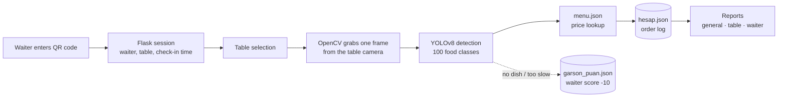
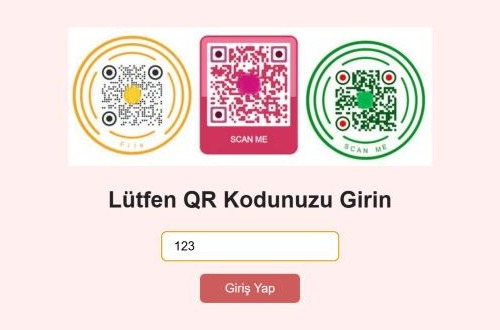
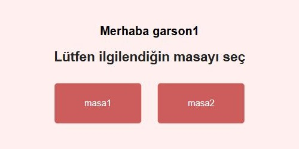
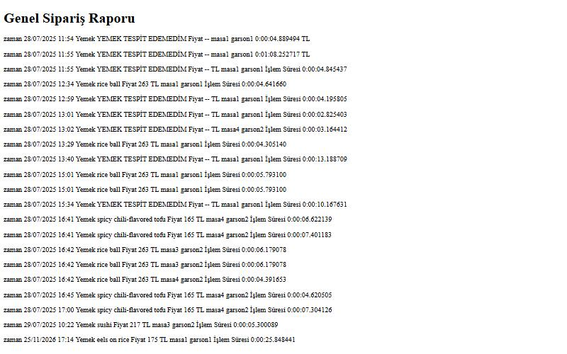
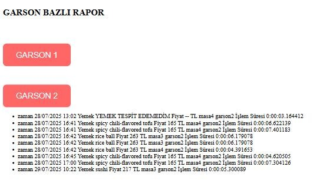
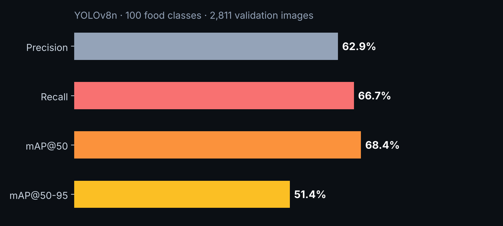

# Restaurant Automation

**Camera-based order recognition and waiter tracking for restaurants, built with YOLOv8 and Flask.**

A camera above each table photographs the plate, a YOLOv8 model recognises the dishes, and the app prices them from the menu, logs the order against the table and the waiter, and keeps a simple performance score for each waiter.

<p>
  
  
  
  
  
</p>

## Architecture



## Screens

| QR check-in | Table selection |
|---|---|
|  |  |

| General order report | Waiter report |
|---|---|
|  |  |

## Routes

| Route | Purpose |
|---|---|
| `/` | Start screen: QR check-in, reports |
| `/qr` | Waiter enters their code; the app looks up the waiter and their tables |
| `/masa` | Waiter selects one of their tables |
| `/yemek` | Captures a frame, runs detection, shows the annotated photo, dishes and prices, logs the order |
| `/rapor` | All orders |
| `/ozellesmisrapor` | Choose a filtered report |
| `/masarapor` | Orders for one table |
| `/garsonrapor` | Orders served by one waiter |

## Data files

| File | Contents |
|---|---|
| `restaurant_config.json` | 4 tables and 2 waiters; each waiter has a QR code and assigned tables |
| `menu.json` | Price (TL) for each of the 100 food classes |
| `hesap.json` | Order log: time, dish, price, table, waiter, service duration |
| `garson_puan.json` | Waiter scores |
| `models/best.pt` | Trained YOLOv8n weights |

## Waiter scoring

| Event | Score |
|---|---|
| Service takes longer than the time limit after QR check-in | −10 |
| Camera cannot recognise a dish | −10 |

## Model

| | |
|---|---|
| Architecture | YOLOv8n (Ultralytics), fine-tuned |
| Training | 50 epochs, 640 px images |
| Classes | 100 dishes (rice, sushi, ramen, curry, pizza, …) |
| Detection threshold | confidence 0.3 |

Validation on 2,811 images, after excluding 11 images with invalid label coordinates:



| Precision | Recall | mAP@50 | mAP@50-95 |
|---|---|---|---|
| 62.9% | 66.7% | **68.4%** | 51.4% |

The validation set has not been verified as independent of the training data, so these figures are an upper estimate rather than real-restaurant accuracy.

## Getting started

```bash
pip install flask ultralytics opencv-python
python app.py
```

Open http://127.0.0.1:5000 and check in with waiter code `123` or `234`. A webcam is required for the detection step; the model path is set in `Restaurant_Automation.py`.

## Roadmap

- Read QR codes from the camera instead of typing them
- Test on photos taken in a real restaurant and add local dishes
- Capture several frames per table and add background images so non-food objects are not detected as dishes
- Move the order log to a database and add a revenue dashboard

## Author

Ezgi Öztürk · [Portfolio](https://ezgiportfolio.vercel.app/restaurant-automation) · [GitHub](https://github.com/Ezgicode)
